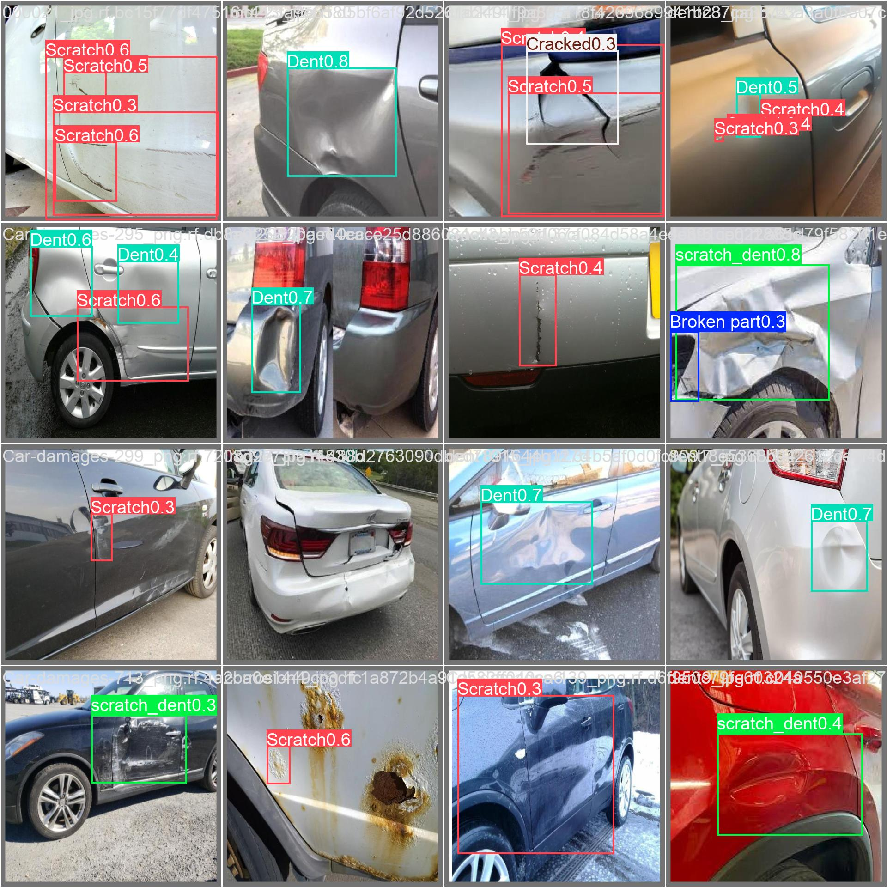
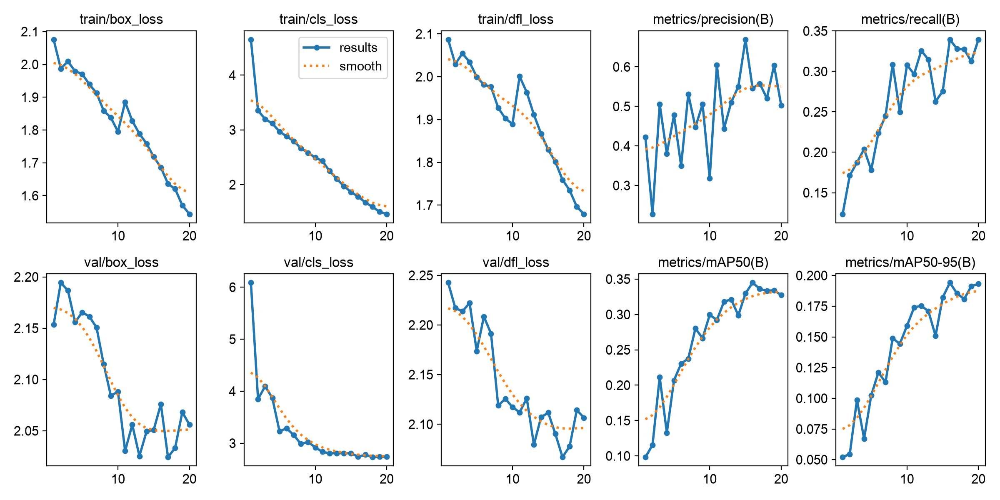

# Vehicle Damage Detection with Transfer Learning and Human Review

A prototype of AI-assisted vehicle damage assessment for a repair business. A YOLO object detection model, fine-tuned from pre-trained weights, finds damage in photos of cars. An assessor then accepts, corrects or rejects each finding on a review screen, and those decisions are saved as new training data. Accepted findings become a draft list of repair operations.

Built in October 2026 by Cindrella Kurinjeri Chandroth, using PyTorch, Ultralytics YOLO11, OpenCV and Streamlit, trained on an Apple-silicon Mac (MPS).



## Data

[Car Damages Segmentation v2](https://universe.roboflow.com/ai-proyect/car-damages-segmentation/dataset/2) from Roboflow Universe, licensed **CC BY 4.0**. It has 2,357 images: 2,133 for training, 173 for validation and 51 for testing, with 10 damage classes.

| Class | Train | Validation | Test |
|---|---|---|---|
| Scratch | 2,186 | 170 | 76 |
| Paint chip | 1,078 | 79 | 30 |
| Dent | 885 | 60 | 39 |
| Scratch and dent | 489 | 40 | 7 |
| Broken part | 384 | 33 | 14 |
| Cracked glass | 276 | 30 | 7 |
| Cracked | 250 | 21 | 11 |
| Corrosion | 179 | 4 | 10 |
| Flat tyre | 123 | 12 | 3 |
| Missing part | 114 | 9 | 0 |

The export used rotated bounding boxes, so `prepare_data.py` converts each one to the tightest upright box and checks every label (class in range, coordinates between 0 and 1, box not empty). No label problems were found.

I chose this dataset over the better-known CarDD dataset because CarDD's licence requires the owners' permission for any use and forbids sharing the images. For a system handling customer photos, data governance starts with the training data.

## Does transfer learning help? Measured, not assumed

Two runs with identical settings (20 epochs, 640-pixel images, same seed). One starts from YOLO11n weights pre-trained on the COCO dataset. The other starts from random weights. Both are scored on the 51 test images, which were never used for training or model selection.

| Measure (test set) | Fine-tuned from pre-trained | Trained from scratch |
|---|---|---|
| mAP50, all classes | **0.237** | 0.165 |
| mAP50, excluding flat tyre* | **0.153** | 0.061 |
| mAP50-95 | **0.128** | 0.100 |
| Recall | **0.237** | 0.127 |

\*Flat tyre has only 3 test examples, and both models score highly on it, which flatters the all-class average. With it removed, the pre-trained model is about **2.5 times better**. The from-scratch model learns flat tyres and cracked glass but finds almost none of the dents, scratches, chips or broken parts.

Per class, the fine-tuned model is strongest on flat tyres (0.91), dents (0.27) and cracked glass (0.27), and weakest on corrosion (0.05), scratches (0.10) and paint chips (0.11).



## Honest assessment

These are modest scores. A tiny model (2.6 million parameters) was trained for 20 epochs on about 2,100 images. Reading the predictions shows where it fails:

- **Corrosion is missed or mislabelled.** On a heavily rusted panel it labelled a rust patch as a scratch and missed the large corroded hole. There are only 179 training examples and 4 validation examples of corrosion.
- **Whole-corner crashes are missed.** A crushed rear end gave no detection, because the training photos are mostly close-ups of single damage.
- **Long scratches get duplicate overlapping boxes.**
- **The test set is small.** With 51 images and as few as 3 examples in some classes, per-class scores move a lot with a single image.

This is why the system routes findings to a person rather than acting on them.

Next steps with real data would be a larger model (YOLO11s or m), more epochs, higher resolution for fine scratches, outlines rather than boxes (segmentation) to measure damage area properly, and above all the repair business's own labelled photos.

## Human in the loop

`streamlit run src/review_app.py`

- The model's findings are drawn on the photo with confidence scores. The assessor can lower or raise the confidence threshold.
- A claim is flagged for review if the model finds nothing, a finding is under 50% confidence, or a damage area is large enough to suggest structural damage.
- For each finding the assessor chooses **accept**, **reject** or **relabel**. Every decision is logged to `feedback/review_log.jsonl` with the assessor's initials and a timestamp.
- Accepted and relabelled findings are saved as YOLO labels in `feedback/dataset/`, ready to be added to the next training run. Rejected findings stay in the log, because they show where the model gives false alarms.
- The feedback tab shows how often assessors accept each damage type, which shows where the model needs most work.

## From damage to a draft repair list

Accepted findings are turned into repair lines using `repair_rules.csv` (for example, a medium dent becomes "Panel repair and refinish, 3.0 hours"). **These rules are illustrative, not a real time guide.** They live in a CSV so an estimator could replace them with the business's own repair times without changing code.

## Run it

On a Mac, put the Roboflow export zip in Downloads and double-click `Run project.command`. Or:

```bash
pip install -r requirements.txt
pytest -q tests                      # 8 fast tests, no dataset needed
python src/prepare_data.py           # unpack, convert and check the labels
python src/train.py --epochs 20      # fine-tuned and from-scratch runs, then test scores
streamlit run src/review_app.py
```

The trained model is included at `models/damage_detector.pt`. The dataset is not included. Download it from the Roboflow link above.

## Project structure

```
src/prepare_data.py   unpack export, rotated boxes to upright boxes, label checks, dataset summary
src/train.py          fine-tuned and from-scratch runs, test-set scoring per class
src/review_app.py     assessor review screen, metrics and feedback tabs
src/feedback.py       review log and corrections saved as training labels
src/repair.py         damage to repair lines, review triggers
repair_rules.csv      editable, illustrative repair rules
tests/                pytest checks for labels, conversion, rules and feedback
reports/              dataset summary and test metrics
```
